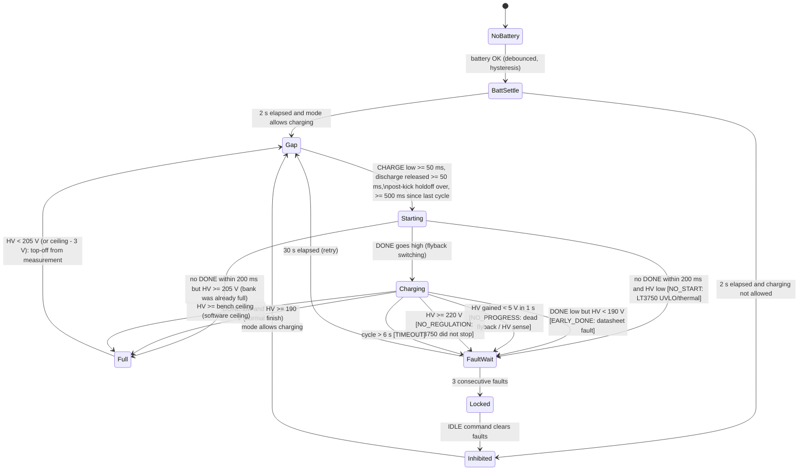
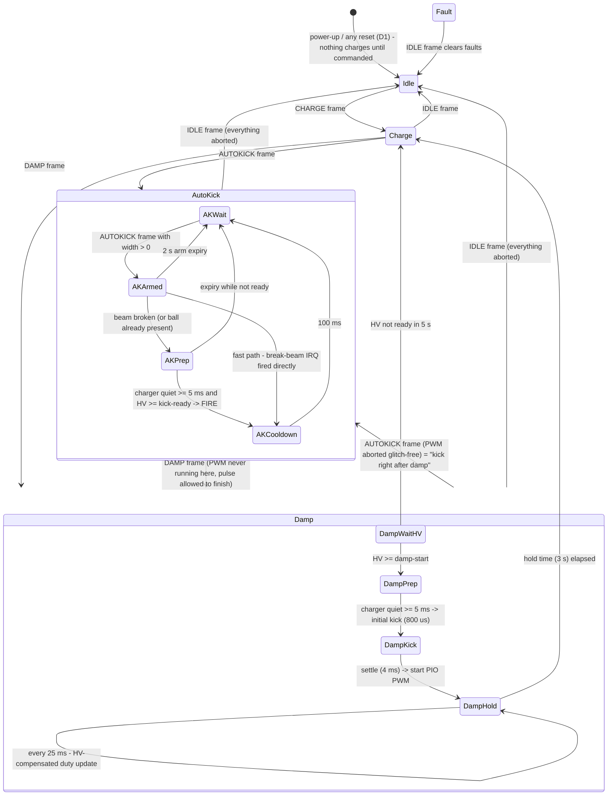

# Chicker Firmware v2 — Plan

Branch: `chicker-fw-v2-sim` (created from `main` @ d0b9b34). **Nothing goes to `main` until it is proven on hardware.**
Language: MicroPython (per Akhil). The structure is kept port-friendly so the Rust work (`origin/rust-firmware`) can adopt it later.
CAN protocol: **v2**, one ID per command with explicit fields (`protocol.py`), plus a 20 Hz heartbeat/status exchange
with the Pi. The old `0x2AA` frame is still accepted (mapped onto the v2 commands) until the robot side switches over.

This file is the running reference: plan, design decisions, notes/ideas backlog, findings, and open questions.
It gets updated as each phase lands.

---

## 0. Done so far

- [x] Recovered `flowcharts/` and `to-test/` from the GitHub Desktop stash (`stash@{0}`, made when switching away from
      `robocup2026damping_henry`). Only those two folders were taken. The stash is left intact (it also holds a small
      `main.py` diff for the damping branch).
- [x] Created branch `chicker-fw-v2-sim` off `main`.
- [x] **Merged `robocup2026damping_henry`** (Henry's newest RoboCup firmware, Jul 2–4) into this branch (`9e1401c`).
  `firmware/main.py` and `high_voltage.py` are now exactly the RoboCup versions. `pulses.py`/`rp2_util.py`/`PWM_test.py`
  (deleted on that branch) are kept as reference. `.gitignore` = union. `main` is untouched.
- [x] Applied the **uncommitted `main.py` edits** GitHub Desktop stashed on 2026-10-24 (`startup_cmhg` typo fix,
  `chg_stop_mode_ctrl` cleanup) as their own commit (`650f040`). The stash is kept.
- **Baseline for v2 = the RoboCup code.** Its tuned constants carry over as `config.py` defaults (section 1f).
- [x] History check for lost RoboCup work (RoboCup 2026, Incheon, commits stamped +0900, Jun 28 – Jul 4):
  - No uncommitted firmware on disk. All firmware files carry checkout times or Jun 16.
  - `stash@{2}` (main, Jul 3 KST): one line, `CAN_LED.value(not_dischg)` debug. Nothing else firmware-related.
  - Reference branches (read-only, nothing imported): `robocup2026damping_henry` (Jul 4, latest damping work),
    `akhil/round2` (Jun 28–30, kick-spam fixes), `akhil/damping`, `origin/rust-firmware` (Steven, Jul 10–12: Rust/Embassy
    rewrite with its own state machine and a different CAN protocol, bench-verified self-test).
- [x] Physics model fitted to your measured kick drops (comments in `main.py`): solenoid **R ≈ 1.72 Ω, L ≈ 2.17 mH**
      (fits 500–2500 µs drops within ~1 V). Charger fitted to your 236 ms → 50 V / 1108 ms → 160 V observations
      (P ≈ 1.16·V^0.67 W, so ~1.6 s for 0 → 210 V).

---

## 1. Phase 1 — New flowcharts + state machine code (first deliverable, review gate)

Goal: replace the flag soup (`chg_stop_mode_ctrl`, `startup_chg_2sdelay`, `charge_toggle_wait`, `check_3s_done`, …)
with **three small, explicit state machines plus one interlocked output stage**. Each one has a single current state.

**Flowcharts are generated from the code.** Every state machine declares a `TRANSITIONS` table (from, to, label). The
step code may only move along a declared transition, and the simulator fails any test that takes an undeclared one.
The Mermaid flowcharts in `flowcharts/` are generated from those tables, so the diagram and the code cannot drift apart.
The simulator also reports which transitions were never exercised (coverage).

### 1a. Power stage (the only code allowed to touch CHARGE and ~DISCHARGE)

| Rule | Why |
|---|---|
| CHARGE=1 is only possible while ~DISCHARGE has been high for ≥ 50 ms | The smoking-resistor incident. Never charge into the dump resistors. |
| ~DISCHARGE=0 is only possible after CHARGE has been low for ≥ 50 ms | Lets the flyback stop before the dump MOSFET turns on |
| Going safe: CHARGE is written low first, then ~DISCHARGE. Going live: ~DISCHARGE high first, then CHARGE (after the dead time) | Ordering guarantee |
| Every write is read back. A mismatch raises, and the top-level handler forces the safe state | Catches a stuck pin or a code bug |
| Boot state = CHARGE low, ~DISCHARGE low (dumping) | Same as the hardware reset/pull-down state |

### 1b. Charge state machine (HV-measurement based, replaces the timing-based charge logic)

The old code ran on timers: re-toggle CHARGE every 5 s, assume "safe charge" ≈ 50 V after 236 ms, check DONE at 4500 ms.
The new one uses the **HV sense pin as the primary measurement**. DONE is the LT3750's own signal, and timeouts are only
backstops.



Global rules (any state): battery lost → `NoBattery`. Mode disallows charging → `Inhibited` (CHARGE low immediately,
mid-cycle included). HV ≥ 225 V → `Locked` (mode machine dumps the bank). CHARGE is **low in every state except
`Starting`/`Charging`**, and that is what makes "never kick while charging" checkable.

### 1c. Mode state machine (cleaned-up version of your mode-control flowchart)



| State group | Charging allowed | Discharge | Kicker |
|---|---|---|---|
| Idle, Fault | no | **yes** | aborted |
| Charge, AKWait, AKArmed, DampWaitHV | yes | no | idle |
| AKPrep (HV below kick-ready) | yes, until ready | no | idle |
| AKPrep (ready), AKCooldown, DampPrep/Kick/Hold | **no** (CHARGE low) | no | firing / PWM |

Command rules:
- A frame with the **same** mode does not restart anything. AUTOKICK re-arms with the new width and refreshes the 2 s
  expiry. DAMP updates freq/duty for the next PWM segment. CHARGE/IDLE are no-ops (IDLE still clears faults).
- A **different** mode aborts PWM immediately. A single kick pulse (≤ 5 ms) is allowed to finish, except on IDLE/fault,
  which abort everything.
- Unknown mode byte / short frame / wrong ID → ignored and counted (matches your flowchart's "unknown command → wait").
- AUTOKICK width 0 → enter AutoKick without arming (old code turned 0 into a 1 µs kick).
- **Fault** is entered when the charge machine locks, on overvoltage, or when kicker self-check/readback fails.

### 1d. Kick / PWM driver: one PIO program, the pin never changes function (fixes problem #4)

Root cause of the PWM ↔ PIO/GPIO problem: switching the KICK pin between peripherals.
- Disabling a running PWM slice or PIO state machine **freezes the pin at its current level**, which can be HIGH.
- PWM duty writes only latch at the next counter wrap, so `duty_u16(0)` followed immediately by `deinit()` can freeze
  the pin high.
- `Pin(…, OUT)` disables the pad pulls. If the pin is released mid-switch, the gate-driver input can hold its last level.

Fix: the KICK pin is handed to **one PIO state machine at boot and never reassigned**. Every instruction drives the pin
through side-set, so it is LOW in every instruction except the on-phase. The program runs "segments" from the FIFO:
`[n_periods-1, high_cycles-2, low_cycles-3]`.
- A kick is 1 segment with n=1, an exact width at 8 ns resolution.
- Damping PWM is a stream of 25 ms segments, so duty updates are glitch-free at period boundaries. Accuracy is
  1 cycle = 8 ns, the same as hardware PWM.
- If the Python loop stalls, the FIFO runs dry and the pin goes LOW by itself. Fail-safe.
- Abort = execute `jmp idle side 0` (pin LOW within one 8 ns cycle), then re-init the state machine (clears the FIFO;
  the pin stays PIO/LOW), then read back the pin level.
- A boot self-check reads the PIO registers (program offset, side-set config) and refuses to arm if anything differs.
- Hard limits are checked in pure functions the simulator tests: kick 50–5000 µs, PWM on-time per period ≤ 200 µs,
  duty ≤ max.
- `KICK_OUTPUT_PIN` in the config can be set to the CAN LED (GPIO6) for a dry run with no solenoid activity.

### 1e. Files (new branch)

```
firmware/
  config.py        ALL constants only (pins, timings, thresholds, limits) — imported by main and every module
  main.py          thin: safe pins first, build board + app, loop, exception -> safe state
  app.py           wires sensors, CAN, mode SM, charge SM, power stage, kicker, telemetry, console
  board.py         real hardware binding (Pin/ADC/PIO/CAN) — the only file importing machine/rp2 directly
  power_stage.py   CHARGE / ~DISCHARGE interlock
  charge_sm.py     charge state machine + TRANSITIONS table
  mode_sm.py       mode state machine + TRANSITIONS table
  kicker.py        PIO program + pure encode/validate functions
  protocol.py      CAN protocol v2 + legacy 0x2AA: decode/encode both directions (pure, shared with sim/bench)
  sensors.py       ADC conversions, battery hysteresis/debounce (pure + thin wrapper)
  canbus/          unchanged library
  legacy/          old main.py, battery.py, high_voltage.py, pulses.py, rp2_util.py, dma_util.py, PWM_test.py (reference only)
  sim/             simulator: MicroPython shims (machine, utime, rp2, canbus), physics, PIO emulator, harness, tests
  bench/           hardware bring-up sweep (host-side) + sim transport so the sweep itself is tested first
  flowcharts/      your originals + generated Mermaid from the code tables
  to-test/         reed switch, HV current estimator, your notes/images
  simulation.ipynb the notebook: low-level → high-level test walkthrough with plots
```

### 1f. Tuned constants carried over from the RoboCup code (`robocup2026damping_henry`) → `config.py` defaults

| RoboCup name | Value | Used for in v2 |
|---|---|---|
| `DAMP_INITIAL_KICK_US` | 800 µs | initial extension kick of a damp |
| settle = `DAMP_INITIAL_KICK_US * 5` | 4000 µs | initial kick start → PWM hold start |
| damp timeout (`damp(..., 3000)`) | 3000 ms | PWM hold duration |
| `DAMP_ADJUST_PERIOD_MS` | 25 ms | HV-compensation update period (= PIO segment length) |
| `DAMP_NOMINAL_HV` / `DAMP_MIN_HV` | 210 V / 60 V | HV compensation `duty·(210/max(HV,60))^0.1` |
| `DAMP_MIN_DUTY` / `DAMP_MAX_DUTY` | 1 % / 95 % | duty clamps (plus a new per-period on-time cap) |
| `DAMP_CATCH_MS` / `DAMP_CATCH_DUTY_BOOST` | 120 ms / +2 % | defined but unused at RoboCup → kept, default off |
| `DAMP_MIN_START_HV` | 206 V | HV needed before a damp starts |
| `KICK_READY_HV` | 180 V | HV needed before an autokick fires |
| `AUTOKICK_EXPIRE_THRESH_MS` | 2000 ms | arm expiry |
| kick cooldown | 100 ms | after every kick |
| kick clamp | ≤ 5000 µs | hard limit |
| `CHARGE_START_CHECK_MS` | 50 ms | DONE-rise check after CHARGE goes high |
| `CHARGE_RETRY_MS` | 30 000 ms | charge-fault retry wait |
| `CHARGE_ALREADY_FULL_HV` | 206 V | "already full" check when DONE never rises |
| battery window | 14.7 – 17.0 V | charge allowed (plus new hysteresis) |
| reference damp | 30 kHz, 12 % | `0x2AA, 2, 0x30, 0x75, 12` — default sim/bench damp |

**Phase 1 review gate:** you review the generated flowcharts and the state tables before Phase 2+ is built on them.

---

## 2. Phase 2 — Simulation environment (runs the real firmware files unmodified)

- **Shim level:** fake `machine`, `utime`, `rp2`, `micropython`, `canbus` modules are put on the path, then the real
  `main`/`app` code is imported. No `if SIM:` branches in the firmware and no fake CAN parser. Tests send **real CAN
  frames** (protocol v2 and legacy 0x2AA) into the fake MCP2515 receive queue, exactly what the robot sends.
- **Virtual time** in integer nanoseconds. `ticks_ms/us` wrap like MicroPython (2^30), so wraparound bugs show up. Each
  HAL call costs realistic CPU time, so loop latency is modelled.
- **Physics model** (fitted where data exists, labelled "uncalibrated" where not):
  - LT3750 flyback: CHARGE edge semantics, DONE open-collector, ~214.9 V stop (Steven's bench reading), fault injection
    (UVLO, no-start, early-DONE, no-regulation, stuck DONE, slow).
  - 2000 µF bank, divider/bleed leakage, dump MOSFET + resistors with a **thermal model**. The "charging into the dump"
    case heats up and fails a test, as it did on the bench.
  - Solenoid RL (fitted), freewheel diode, plunger + ball mechanics (uncalibrated: relative comparisons only), break-beam.
  - ADCs: dividers, RC filter on HV sense (~1.2 kHz), 12-bit quantisation, noise, `read_u16` scaling. Battery with
    internal resistance and sag while charging.
- **PIO emulator:** captures the real `@rp2.asm_pio` program by running the same DSL, executes it cycle-accurately (with
  fast-forward of count loops), and models `exec`, FIFO, active/inactive freeze, and register reads.
- **PWM model** (used to replay the old firmware): duty latch at wrap, freeze on deinit, pin-function tracking.
- **Interrupts:** hard IRQs can fire between any two HAL calls, and `disable_irq` is honoured, so race conditions
  (break-beam vs charge start) are tested.
- **Invariant monitor** (checked on every pin change, any violation fails the test):
  1. CHARGE high while ~DISCHARGE low
  2. dead-time violated in either direction
  3. KICK high while CHARGE high
  4. KICK continuous high > 5000 µs
  5. PWM on-time/duty above limits
  6. KICK high outside a firmware-initiated fire/damp window
  7. KICK pin function changed after boot
  8. charge cycles closer than the minimum interval
  9. HV > 225 V
  10. dump resistor over-temperature
  11. CHARGE high > cycle timeout
  12. exception left outputs unsafe

## 3. Phase 3 — Comprehensive tests (notebook + plain test runner, low level → high level)

`python -m sim.run_tests` runs everything with no extra installs (no pytest needed). `simulation.ipynb` runs the same
suites with plots:
1. **Model calibration**: kick drops vs your measured table, charge curve vs your timings.
2. **Sensors**: ADC conversion round-trips, battery hysteresis/debounce sweep, noise.
3. **Protocol**: every mode byte 0–255, every length 0–8, wrong IDs, fuzzed payloads.
4. **Power stage**: randomized request sequences, both invariants and dead times.
5. **Kick driver (PIO)**: pulse widths 50–5000 µs exact to 8 ns; PWM grid (freq × duty) vs ideal and vs hardware PWM;
   segment streaming continuity; abort at random instants (pin low ≤ 1 cycle); no function switches; Python-stall
   failsafe.
6. **Charge SM**: normal charge, top-off from HV, battery unplug/replug/sag, every LT3750 fault mode, overvoltage, HV
   sense failures, ceilings.
7. **Mode SM / system**: every mode → mode transition injected at random phases (mid-charge, mid-kick, mid-settle,
   mid-hold), kick right after damp, damp right after kick, arm/expiry, ball already present, repeated frames, frame
   storms, unknown modes, tick wraparound, exception injection, break-beam vs charge-start races.
8. **Soak/fuzz**: long random sim runs with random commands + faults, all invariants on.
9. **Legacy replay**: run the old `robocup2026damping_henry` `main.py` (read via `git show`, not copied) in the same sim,
   to show it reproduces the smoke condition and the PWM-switch glitch. This proves the simulator catches real bugs.
10. **Damping study** (indicative): COR vs duty/freq/HV.
11. **Transition coverage report** for every state machine.

## 4. Phase 4 — Hardware bring-up sweep (`bench/`)

A host-side script that steps the real board through a staged, **ceiling-limited** test. Every stage has pass/fail
criteria. Any anomaly sends IDLE, waits for the bank to bleed below 10 V, and stops. The same procedure first runs
against the simulator (sim transport), so the sweep itself is tested before it touches the board.

1. **Pre-flight checklist** (typed confirmation): solenoid secured, kicker face clear, current-limited supply recommended.
2. **Connect/identify**: firmware version, config hash, reset cause, kicker self-check result. Forces IDLE.
3. **Static sensors (0 V bank)**: battery and 5 V vs your multimeter readings, HV ≈ 0, DONE, break-beam (operator
   blocks/unblocks), SHELL_OFF.
4. **Dry fire, no HV** (bank dumped, ≤ 5 V): kick pulses and PWM bursts on the real pin (or the LED pin), 100× random
   aborts with pin readback. This tests problem #4 on hardware at zero energy.
5. **Low-voltage charge (30 V ceiling)**: DONE rises, HV rate vs model, stops at ceiling, overshoot ≤ 5 V. Then IDLE →
   measure the dump decay τ, which **proves the discharge path** and tells us R_dump.
6. **Low-voltage kick and damp (30 V)**: HV sag vs model; damp hold sag; IDLE mid-hold → immediate stop.
7. **Voltage ladder** 60 → 100 → 150 V, repeating 5–6 with operator confirmation at each step. Sag must scale as
   predicted (±40 %).
8. **Full voltage**: stop point 205–216 V, single 500 µs kick (expect ≈ 6.4 V drop from your table), one standard damp.
9. **End**: IDLE, wait for < 10 V, write CSV log + summary.

Throughout, the bench tool watches telemetry: missing for > 300 ms, CHARGE & ~DISCHARGE both active, HV > ceiling + 10 V,
or an unexpected fault → abort.
Transport (D4): **USB serial only**. Commands go into the same frame decoder as CAN; telemetry comes back on the same
port. CAN hardware is checked by the MCP2515 loopback self-test (N22). Later, when the board is on a robot, the same
sweep can run over real CAN.

## 5. Phase 5 — `to-test/` items (kept out of the main firmware)

- **Reed switch → analog**: move `main-reedCOPY.py` (has unresolved merge-conflict markers) + notes. Proposed circuit on
  GPIO28/ADC2: pull-up R_u, switch in series with R_s, both in parallel with R_p. That gives **four distinguishable
  bands**: closed / open / wire broken (3.3 V) / wire shorted (0 V). Classifier + sim test included.
- **Solenoid current from HV sense** (your `claude-current-fromHV.txt` idea): fix and evaluate in the simulator before
  any hardware time is spent (see N7).

---

## 6. Notes / ideas backlog (things worth doing — referenced as N#)

| # | Idea | Why | Status |
|---|---|---|---|
| N1 | **HV-based charge control** (top-off threshold, software ceiling, progress/rate checks, plausibility at DONE) | Replaces the 5 s re-toggle and the "236 ms ≈ 50 V" timing guess; works regardless of battery/charger speed | Phase 1 |
| N2 | **HV-compensated kick width**: pick the pulse width from the fitted R/L model so energy (or ball speed) is the same at any bank voltage | Your flowchart note "could do HV scaling here"; makes kick-after-damp (lower HV) consistent. Your data already shows 1000 µs@210 V ≈ 1500 µs@120 V | Model in Phase 2; firmware option after bench validation |
| N3 | **Per-kick energy log**: HV before/after every kick → ½C(V₁²−V₂²) in telemetry | Free health check: open solenoid (no sag), weak IGBT, wrong width | Phase 1 telemetry |
| N4 | **Discharge-path self-check** every time IDLE dumps: fit the decay τ, fault if HV doesn't fall | The dump is the last line of defence; currently nothing checks it works | Phase 1 (warn), bench measures R_dump |
| N5 | **Capacitor health**: estimate bank C from charge rate or from known kick energy; track over time | Electrolytics age; a dying cap changes kick strength silently | Later |
| N6 | **Leakage/droop monitor** in `Full` (charger off) | Detects a leaky cap or a stuck dump MOSFET | Later (cheap) |
| N7 | **Solenoid current / ball-contact detection from HV derivative** | Closed-loop damping: detect impact, then adjust hold. Needs fixes: the note reads ADC(26) = **battery** pin (HV is GPIO29); `_thread` sampling races the main thread on the shared ADC mux; Δt isn't constant (use ADC free-run + DMA); sense bandwidth ≈ 1.2 kHz (RC on HV feedback); resolution ≈ 1 A/LSB at 128 µs windows | Feasibility study in sim (Phase 5) |
| N8 | **Hard-IRQ break-beam fast fire** (pre-validated "fast_ok" flag, critical sections with `disable_irq`) | Kick latency from µs instead of a main-loop iteration; ball moves ~5 mm per ms | Phase 1 |
| N9 | **Reed switch analog diagnostics** (4-band circuit) | Distinguish open/closed/broken/shorted | to-test |
| N10 | **Hardware CAN filter** (mask 0x7F0, filter 0x2A0 → accepts 0x2A0–0x2AF) | Old code accepts *every* frame on the shared motor bus. MCP2515 has only 2 RX buffers, so 0x2AA commands can be lost to overflow, and draining costs CPU. Library encoding verified correct | Phase 1, config flag; confirm on bench |
| N11 | **Status frame to the Pi** over CAN (state, faults, HV, kick energy) | Your flowchart's "Locked → message pi4 to substitute". Needs a CAN ID agreed with the team | Needs ID — open question |
| N12 | **Comms heartbeat** (flowchart has it) | Board drops to IDLE if the Pi dies | See D2 / N23 |
| N13 | **Hardware watchdog** (machine.WDT) | Hung loop → reset → pull-downs = safe state | Always on, 1 s, 3 s boot window (D5) |
| N14 | **Battery hysteresis + debounce** | Old thresholds have none; charging sags the pack ~0.2–0.3 V → charge_ok chatter at 14.7 V | Phase 1 |
| N15 | **No prints in the hot path**, rate-limited telemetry | The RoboCup code already removed the print from `SenseHV()`. Remaining "kick delayed?" suspects: the kick waits for `done_state == 0` *and* a fresh `SenseHV() >= 180`, the post-kick recharge goes through the 2 s battery-settle path, plus status prints in the loop. Sim will measure command→kick latency | Phase 1 |
| N16 | **Tick-wrap-safe timing** (`ticks_diff`) everywhere | Old code subtracts `ticks_us()` directly; that wraps every ~17.9 min, so damp timing breaks after ~18 min uptime | Phase 1 + sim test |
| N17 | **Reset-cause aware boot** (boot IDLE after a watchdog reset) | Avoid auto-charging into a repeating fault | Phase 1 |
| N18 | **Finer duty resolution** (e.g. 0.1 % units) in a future protocol rev | Damping is very sensitive; the PIO can do 8 ns but the protocol only sends whole % | Later (robot-side change) |
| N19 | **HV auto-calibration** against the LT3750 stop point (~214.9 V indicated) | Divider tolerance (990 kΩ string) dominates HV error; the charger's stop is a free reference | Later |
| N20 | **Port-friendly structure** (TRANSITIONS tables, pure functions) | Lets the Rust firmware adopt the validated behaviour 1:1 | Phase 1 |
| N21 | **Charge-rate model check**: compare dV/dt during charge to the fitted P(V) curve | Early warning for flyback/transformer/battery problems | Later (cheap once N1 exists) |
| N22 | **MCP2515 loopback self-test at boot** | Verifies SPI + CAN controller + decode with no bus or adapter (D4) | Phase 1 |
| N23 | **Heartbeat + STATUS exchange at 20 Hz** (protocol v2) | Comms-loss → IDLE; AI sees HV, beam and kick-ready (D2) | Phase 1 (firmware), robot side later |
| N24 | **"Constant hold force" damping compensation** `D₀·V_start/V` | Keeps the plunger held as caps drain, never stiffer than the tuned point (D6) | Phase 1 + sim study |

---

## 7. Findings in the existing code (bugs the new design removes)

1. **A second path to "charging + discharging".** Henry reports the smoking-resistor incident itself is fixed (most
   likely the boot case, `18b0320 not discharge starts at 1`). In the merged RoboCup code, though, another route to the
   same condition is still present. `idle()` sets `not_dischg = 0` (main.py:295) but never clears `charge`. `charge` is
   only reset in the `else` at main.py:782, which runs on battery/chip-level errors, not on a mode change. So an IDLE
   frame arriving while CHARGE is high leaves CHARGE high with ~DISCHARGE low. If that happens mid-cycle, the LT3750
   keeps charging into the dump resistors: with ~1 kΩ it settles near ~200 V, never reaches its ~215 V stop, and keeps
   delivering ~40 W. **To be confirmed, not assumed:** the legacy replay (Phase 3, item 9) runs the RoboCup code in the
   simulator with an IDLE frame mid-charge. The v2 power stage (1a) makes this state impossible either way.
2. Same pattern on the battery-low path: `charge=0` and `not_dischg=0` in the same loop, no dead time.
3. DAMP sets `chg_stop_mode_ctrl=1` but doesn't clear `charge`, so a charge cycle in progress keeps running during the
   damp hold.
4. PWM ↔ GPIO/PIO switching glitches (1d).
5. On `main`, damping PWM is generated by re-firing DMA once per period from a Python loop. Timing gaps make the
   effective duty inaccurate, and the call blocks for the whole 3 s hold (no CAN, no abort).
6. HV compensation in damping: `int(duty * (210/HV)**0.1)` truncates to whole %, so for typical duties (≤ ~20 %) it
   **never changes the duty**. Your current tuning was effectively done without compensation. (Decision needed, see Q6.)
7. `startup_cmhg` typo on the damping branch (IDLE/DAMP → AUTOKICK never got a fresh charge cycle). Fixed by Henry's
   stashed edit, now committed on this branch (`650f040`).
8. DONE fault polarity comment is backwards: per the LT3750 datasheet (and Steven's bench work) faults pull DONE **low**.
   Your firmware's check still caught it as "no start", by luck.
9. `ticks_us()` raw subtraction (N16); prints in hot paths (N15); ADC(26) vs GPIO29 in the HV-current note (N7);
   accept-all CAN filter (N10).

---

## 8. Decisions (answered by Henry, 2026-10-24)

| # | Question | Decision → design |
|---|---|---|
| D1 | Power-up mode | **Always boot IDLE** (bank dumping, no charging) until the robot commands. Same after a watchdog reset. |
| D2 | Robot traffic | Frames are sent **only on commands** (kick/damp/…). → Add a **heartbeat** (design below). |
| D3 | Dump resistors R44/R48 | **Parallel**: 2 × 2 kΩ = **1 kΩ**, τ = R·C = 2 s. Peak dump ≈ 46 W total (23 W each) at 215 V. Sim uses 1 kΩ. |
| D4 | Bench comms | **No USB-CAN adapter.** The host script must command the board with no robot. → USB serial command path (below). |
| D5 | Watchdog | Run it **all the time** (design below). |
| D6 | Damping HV compensation | **Must be tuned.** It must keep the plunger held as the caps drain, but never add so much power that the catch turns elastic. → Bounded "constant hold force" law + sim study (below). |
| — | Smoke incident cause | `~DISCHARGE` was a new pin on the RP2040 board and the code never asserted it (left low = dumping) while charging. Fixed by `18b0320`. v2: the power stage owns and explicitly drives both pins from the first line, with readback. |

### D2 → CAN protocol v2 + heartbeat/status exchange (Henry's direction, implemented in `protocol.py`)
- **No more packed/overloaded bytes**: one ID per command, every field has one meaning. A few extra bytes cost nothing.
- IDs (block `0x2A0–0x2AF`, all in `config.py`; ⚠ confirm with Akhil/Steven that the block is free on the robot bus):

| ID | Dir | Payload (little-endian) |
|---|---|---|
| `0x2A0` MODE | Pi → board | `[mode]` 0 = IDLE (dump), 1 = CHARGE (charge and hold) |
| `0x2A1` KICK | Pi → board | `[trigger, width_us u16, arm_ms u16]` trigger 0 = on break-beam, 1 = now |
| `0x2A2` DAMP | Pi → board | `[freq_hz u16, duty u16 (0.01 %), hold_ms u16, init_kick_us u16]` (0 = default) |
| `0x2A4` HEARTBEAT | Pi → board | `[seq]` at **20 Hz** — independent of commands |
| `0x2A8` STATUS | board → Pi | `[mode_state, charge_state, flags, hv u16 (0.1 V), batt (0.1 V), fault, seq]` at **20 Hz** + immediately on changes |
| `0x2A9` EVENT | board → Pi | `[code, a u16, b u16, c u16, seq]` kick fired (width, HV before/after), damp done, fault, command rejected, comms lost … |
| `0x2AA` LEGACY | Pi → board | old `[mode, value, duty]` frame, still accepted and mapped onto the commands above |

- STATUS flags: break-beam, **kick-ready** (so the AI knows a kick would fire now), damp-ready, armed, charging,
  discharging, heartbeat-OK, reed switch (raw now, analog version when it moves out of `to-test/`).
- Heartbeat loss (`HEARTBEAT_TIMEOUT_MS` = 300 ms, 6 missed) → **IDLE** (bank dumped) + `COMMS_LOST` event.
  `HEARTBEAT_MODE`: 1 = enforce after the first heartbeat (default, lets the legacy robot code keep working),
  2 = strict from boot, 0 = off.
- KICK / DAMP in IDLE are **rejected** (with a `CMD_REJECTED` event): the robot must send MODE CHARGE first.
  Legacy frames keep the old behaviour (they imply CHARGE).
- Bus load: 2 × 8-byte frames at 20 Hz ≈ 2 % of 250 kbps.

### D4 → Commanding the board with no CAN adapter
- The firmware gets a **USB serial command console** (non-blocking poll). `can 2A1 00 E8 03 00 00` (or shortcuts like `kick 1000`) is fed into the **same
  `protocol.decode()` and mode state machine as a CAN frame**, so the logic under test is identical. Only the transport
  differs.
- Host side: `bench/chicker_link.py` (pyserial — `pip install pyserial`) used by the bench sweep and for manual
  commands (`python -m bench.send kick 1000`, `damp 30000 12`, `idle`, …). Close Thonny first, because it holds the port.
- In the simulator the same host code talks to a simulated board, so the bench scripts are tested before they touch
  hardware.
- Gap this leaves: the MCP2515 receive path isn't exercised on the bench. → **N22**: boot self-test puts the MCP2515
  in **loopback mode**, sends itself a test frame (`0x2AF`) that must come back and one outside the filter that must not, then goes to normal mode. That verifies
  SPI + MCP2515 + decode without a bus or adapter.

### D5 → Watchdog design
- RP2040 hardware watchdog, **1000 ms** timeout. It's fed once per main-loop pass, **only while the loop is healthy**
  (HV ADC read fresh, power-stage readback OK). A hung loop, a wedged SPI read or a MicroPython crash stops the feeding
  → chip reset → every pad back to pull-down (CHARGE off, `~DISCHARGE` low = dumping, KICK low) → boots **IDLE** (D1).
- Boot reports `reset_cause=WDT` in telemetry, so silent resets are visible.
- Development: once started, the RP2040 watchdog can't be stopped. So pressing Stop in Thonny means a reboot ~1 s
  later. Mitigation: main.py waits **3 s at boot before starting the watchdog**, a window to press Stop and get the REPL.
  Because the board boots IDLE, a watchdog reboot is harmless (just a dump and wait).
- Constraint it imposes: nothing may block > ~500 ms. The v2 loop has no blocking calls (kicks/PWM run in PIO).
  The sim measures worst-case loop time.

### D6 → Damping compensation: physics + proposal
- At 30 kHz the PWM period (33 µs) is much shorter than the solenoid's L/R ≈ 1.26 ms. The coil current is therefore
  ≈ continuous: **I ≈ D·V/R**, and holding force ∝ I² ∝ **(D·V)²**.
- Consequences:
  - **Old law `D·(210/V)^0.1` barely compensates**: at 150 V it raises duty by 3.4 % (relative) but force still falls ~45 % (vs ~49 % with no compensation), and
    whole-% truncation removed even that. That fits the "plunger falls back" symptom.
  - **Whole-% duty steps are ~17 % force steps** at 12 % duty ((13/12)² = 1.17). That is why tuning feels so
    sensitive. The PIO driver gives 0.024 % steps at 30 kHz → smooth (also supports N18).
- Proposal, **"constant hold force" law**: `D(t) = D₀ · V_start / V(t)`, where `V_start` = HV measured at hold start.
  - At the start the duty is exactly your tuned D₀, so the tuning carries over unchanged.
  - As the bank drains, D·V (and the force) stays at the tuned value: the plunger stays held.
  - It **never exceeds the force at the tuned operating point**, so it can't drift towards an elastic catch.
- Bounds: gain `V_start/V` capped by `DAMP_COMP_MAX_GAIN` (default 2.0) and `DAMP_MAX_DUTY`, plus the per-period
  on-time cap. Below `DAMP_MIN_HV` the hold ends (nothing useful left).
- Options kept for A/B on the robot: `DAMP_COMP_MODE = "hold_force"` (default) / `"legacy"` (your old formula,
  whole-%) / `"off"`.
- Sim study (Phase 3, item 10): COR vs D₀, frequency, start HV and compensation mode, with ball impacts mid-hold. It
  narrows the tuning range before robot time. Mechanics are uncalibrated, so it's a relative guide, not absolute.

### D6b → The 1 cm solenoid move and the power budget (why damping got so hungry)
Context (Henry): the solenoid moved 1 cm back for clearance. The larger air gap needs more power to extend and to hold,
so the RIO-2025 / `solenoid-active-damping` numbers (≈30 V/s hold drain, ≈2 s holds) no longer apply. Everything was
retuned at RoboCup 2026.

- Bank power drawn by the hold: supply current = D·I, so **P ≈ D²·V²/R_eff** (with I ≈ D·V/R).
- With the fitted R = 1.72 Ω, the RoboCup setting (12 % at 210 V) predicts **≈ 370 W**: the 44 J bank would be empty
  in ≈ 0.12 s. The old 30 V/s drain at ~200 V was only ≈ 12 W. That is the "caps drain so much more" symptom, if the
  model holds. ⚠ The kick-drop table R/L was fitted to may itself predate the move, so **measuring this is damping
  job #1** (P1 below).
- A useful property: with the constant-hold-force law, D·V is constant, so **P is constant**. Energy falls linearly and
  the hold time left is predictable: `t = (½CV² − ½CV_min²) / P`.

Power-limit features and tests:

| # | What | Firmware | Sim test | Bench test |
|---|---|---|---|---|
| P1 | **Measure hold power**: HV sag during each hold → avg power, energy used | `EV_DAMP_DONE` carries HV start/end + hold time | power computed from sag matches the model | hold sweep at a 30–60 V ceiling, several duties → fit `R_eff` (new air gap) → predicted full-voltage power |
| P2 | **Predicted-power clamp**: duty limited so D²V²/R_eff ≤ `DAMP_MAX_HOLD_POWER_W` | in `kicker.damp_duty()` | clamp never exceeded across a freq × duty × HV grid | measured power ≤ limit at every ladder step, else abort |
| P3 | **Force bound**: compensation never pushes D·V above D₀·V_start (never stiffer than tuned) | `damp_duty()` | property test on the law | — |
| P4 | **HV floor**: hold ends below `DAMP_MIN_V`, so a kick is still possible after a catch | mode SM | test | observed in sweep |
| P5 | **Hold-time budget in STATUS/EVENT**: predicted ms of hold left at current power | later | — | — |
| P6 | **Re-fit the solenoid model** from bench kicks (pulse width, HV before/after) | — | sim loads the bench calibration file | kick ladder records data |

More ideas for faster tuning (for discussion):
- **Command damping by "hold drive" instead of duty**: send the effective coil voltage D·V (e.g. 25 V) and let the
  board compute duty from live HV. Tuning then doesn't depend on bank voltage at all. Possible DAMP field later.
- **Send DAMP as late as possible** (AI side): at hundreds of watts every 100 ms of hold costs bank energy. The AI
  should start the hold from ball ETA, and `hold_ms` is now in the command for exactly this.
- **Plunger-extended sensor** (hall/reed at the end stop): closed-loop "minimum duty that keeps it out" auto-tune. This
  is the most direct way to automate the tuning (hardware idea, next revision).
- **Bench "find minimum hold" routine**: at a safe ceiling, extend and step the duty down until the operator reports the
  plunger dropped. Scale the result to full voltage with the D·V law → first full-voltage guess.

## 8b. Still open

1. **CAN ID block `0x2A0–0x2AF`** for protocol v2: confirm with Akhil/Steven it's free on the robot bus.
2. **Kick-ready voltage** after a damp (old: 180 V): wait for recharge, or fire lower with HV-compensated width (N2)?
   Default for now: wait for 180 V, same as RoboCup.

---

## 9. Ground rules for this work

- No commits to `main`, no pushes, no merges, no edits to other branches/stashes without asking.
- Old code is used as reference via `git show`; nothing is imported from other branches.
- CAN protocol v2 is documented in `CHANGES-v2.md` for Akhil/Steven; legacy 0x2AA stays accepted until the robot switches.
- Every safety rule has a simulator test that fails if the rule is broken.
